# Setting up OpenClaw with a local model (Ollama)

**Audience:** You can use a terminal, but you've never set up an AI agent before.
**Time:** 30–45 minutes. Most of that is waiting for downloads.
**Result:** OpenClaw running on your own computer, using a free local AI model through Ollama, with a web dashboard you can chat in.

> **About the screenshots.** We took every screenshot during a real install of **OpenClaw 2026.10.7** and **Ollama 0.40.11** on a Linux computer (Debian 13). We didn't edit any command output. The commands are the same on macOS and inside Windows WSL2. Where a macOS or Windows screen looks different, you'll see a placeholder marked 📸.

---

## Contents

1. [What you'll need](#1-what-youll-need)
2. [Install Ollama](#2-install-ollama)
3. [Download a model](#3-download-a-model)
4. [Install OpenClaw](#4-install-openclaw)
5. [Run onboarding and point it at Ollama](#5-run-onboarding-and-point-it-at-ollama)
6. [Start the Gateway and open the dashboard](#6-start-the-gateway-and-open-the-dashboard)
7. [Your first test chat](#7-your-first-test-chat)
8. [Safe permission defaults (do this before the lab!)](#8-safe-permission-defaults-do-this-before-the-lab)
9. [Troubleshooting](#9-troubleshooting)
10. [Uninstall](#10-uninstall)

---

## 1. What you'll need

| | macOS | Windows |
|---|---|---|
| OS | A recent macOS release (Apple Silicon recommended) | Windows 10 20H2+ or Windows 11, with **WSL2** (we set it up below) |
| Memory (RAM) | 8 GB minimum, **16 GB recommended** | 8 GB minimum, **16 GB recommended** |
| Free disk | ~10 GB | ~10 GB |
| Node.js | 24.16+ or 26.1+ (the OpenClaw installer adds it if it's missing) | Same, but inside WSL2 |
| Internet | Only for downloads. After setup, the model runs offline. | Same |

**Why a local model?** Ollama runs the AI model on your own computer, so there's no API key, no bill, and your data stays on your machine. The tradeoff is that small local models are slower and less capable than cloud models. You'll study that tradeoff in the lab.

### Windows only: set up WSL2 first

OpenClaw supports several Windows paths: the native **Windows Hub** app, a PowerShell installer, and **WSL2**. The OpenClaw docs call WSL2 "the most Linux-compatible Gateway runtime on Windows." This course uses WSL2 so that everyone types the same commands as Mac users.

1. Open **PowerShell as Administrator** and run:
   ```powershell
   wsl --install -d Ubuntu-24.04
   ```
2. Restart when Windows asks you to. Then open **Ubuntu** from the Start menu and create a Linux username and password.
3. Turn on systemd inside WSL so OpenClaw can run as a background service. In the Ubuntu terminal, run:
   ```bash
   sudo tee /etc/wsl.conf >/dev/null <<'CONF'
   [boot]
   systemd=true
   CONF
   ```
4. Back in PowerShell, run `wsl --shutdown`, then reopen Ubuntu.

> 📸 Screenshot needed: Windows — PowerShell running `wsl --install -d Ubuntu-24.04`
> 📸 Screenshot needed: Windows — first launch of Ubuntu asking for a UNIX username

**From here on, Windows users type every command in the Ubuntu (WSL2) terminal, not in PowerShell.**

---

## 2. Install Ollama

Ollama downloads, stores, and runs AI models on your computer.

**macOS:** Download the app from <https://ollama.com/download>, drag it into Applications, and open it. A llama icon appears in your menu bar. Then check that it works in Terminal:

```bash
ollama --version
```

> 📸 Screenshot needed: macOS — Ollama.app in the Applications folder / menu-bar icon

**Windows (inside WSL2) and Linux:** Run the official install script:

```bash
curl -fsSL https://ollama.com/install.sh | sh
```

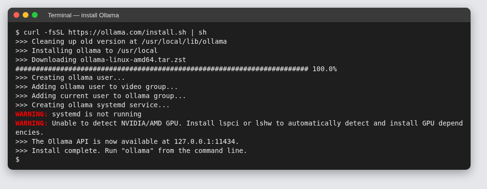

*Real output. The two `WARNING` lines are normal on a computer without a GPU: Ollama falls back to the CPU, which is slower but works fine.*

> **Windows note:** Ollama also ships a native Windows installer. Because OpenClaw runs inside WSL2, it's simplest to install Ollama inside WSL2 too, so that both programs share `localhost`.

**Is Ollama running?** The Mac app and the Linux/WSL service start Ollama automatically. If `ollama list` says it can't connect, start it yourself in a separate terminal and leave that terminal open:

```bash
ollama serve
```

---

## 3. Download a model

OpenClaw needs a model that supports **tool calling**, so it can run commands and read files. The model also needs a context window of **at least 16K tokens**. We recommend the Qwen 3.5 family:

| Your RAM | Model | Download size |
|---|---|---|
| 8 GB | `qwen3.5:2b` | ~2.7 GB |
| 16 GB+ | `qwen3.5:4b` (smarter, slower) | ~3.4 GB |

```bash
ollama pull qwen3.5:2b
```

Then confirm the model is installed and supports tools:

```bash
ollama list
ollama show qwen3.5:2b
```

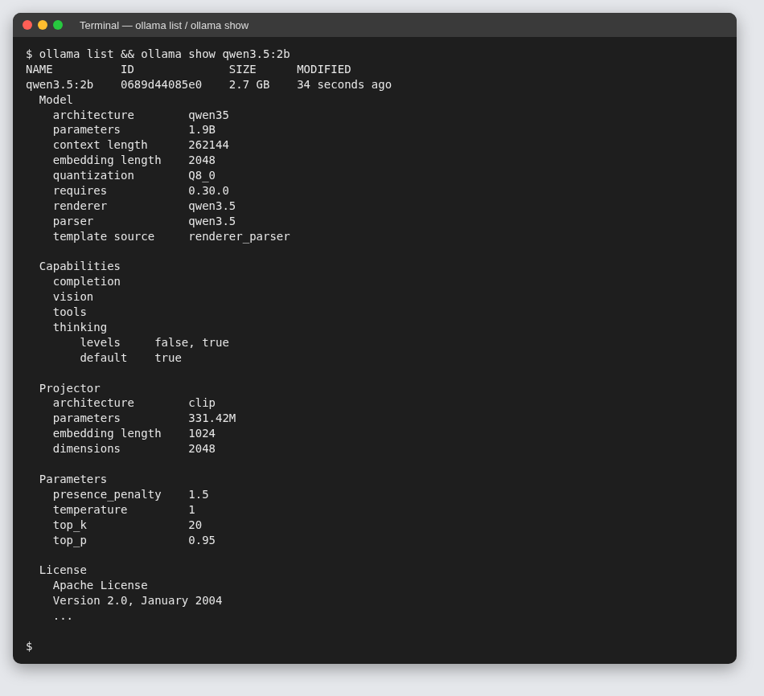

Look for **`tools`** under *Capabilities*. That line means the model can call tools, which is what turns a chatbot into an agent.

**Quick sanity test.** This also loads the model into memory, which makes the next step easier:

```bash
ollama run qwen3.5:2b --keepalive 2h --think=false "In one sentence, what is an AI agent?"
```

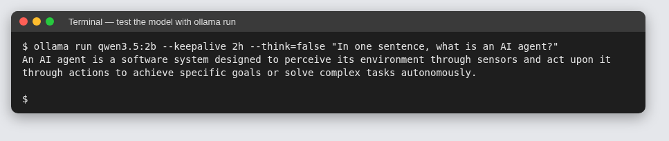

> **Why `--keepalive`?** When OpenClaw onboarding auto-detects models, it only considers models that are **already loaded in memory**. Running the model once with a long keep-alive makes sure onboarding finds it.

---

## 4. Install OpenClaw

The official installer detects your OS, installs or upgrades Node.js if needed, installs OpenClaw, and normally starts onboarding right away. We add `--no-onboard` so we can take onboarding one step at a time:

```bash
curl -fsSL https://openclaw.ai/install.sh | bash -s -- --no-onboard
```

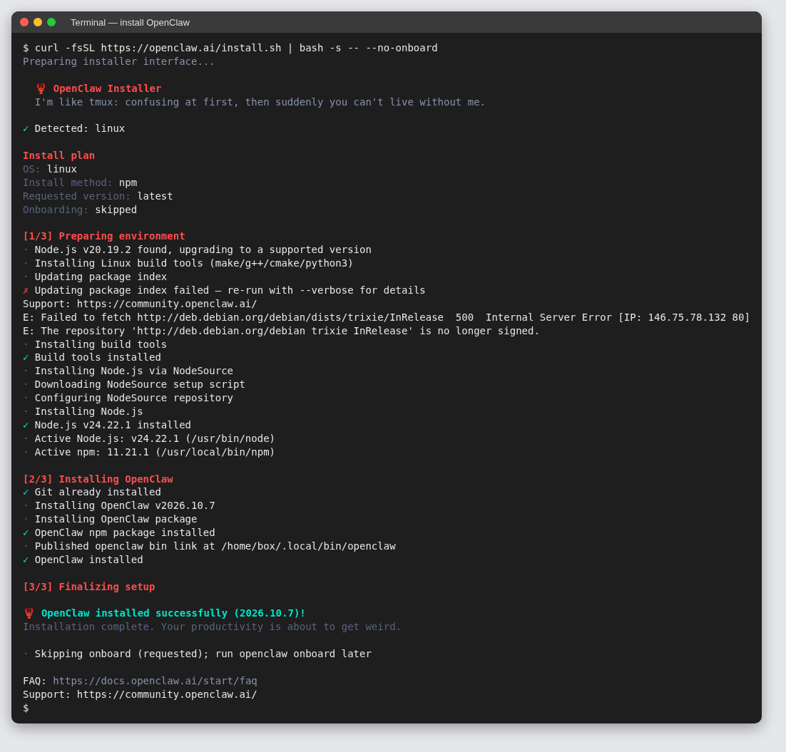

What happened in this real run:
- **Node 20 was too old**, so the installer upgraded it to **Node 24.22.1** automatically.
- A temporary package-mirror error (`500 Internal Server Error`) appeared but didn't stop the install. You can ignore this kind of message if the next steps succeed.
- OpenClaw was installed to `~/.local/bin/openclaw`.

Confirm it worked. Open a **new terminal** first so your `PATH` updates:

```bash
openclaw --version
```

> If you get `openclaw: command not found`, see [Troubleshooting](#9-troubleshooting).

> 📸 Screenshot needed: macOS — installer output in Terminal (the installer uses Homebrew/Node 26 on macOS, so it looks slightly different)

---

## 5. Run onboarding and point it at Ollama

```bash
openclaw onboard
```

**Step 5a: welcome and security notice.** Read it. OpenClaw runs an AI agent with *real access to your computer*. Choose **Quick start (recommended)** and press Enter.

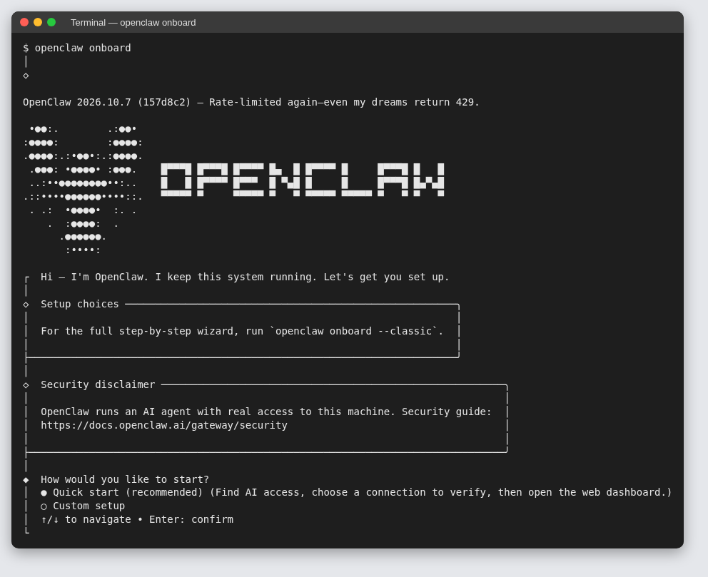

**Step 5b: choose "One agent."**

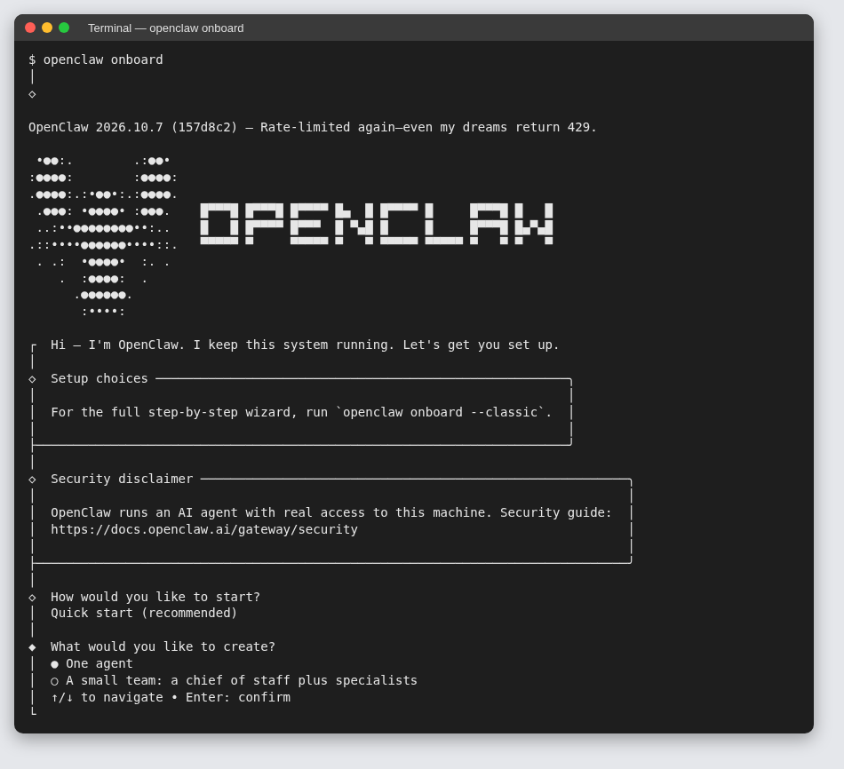

**Step 5c: OpenClaw finds Ollama.** It should show `Ollama — qwen3.5:2b at http://127.0.0.1:11434`. Choose **Detected on this machine (Ollama)**.

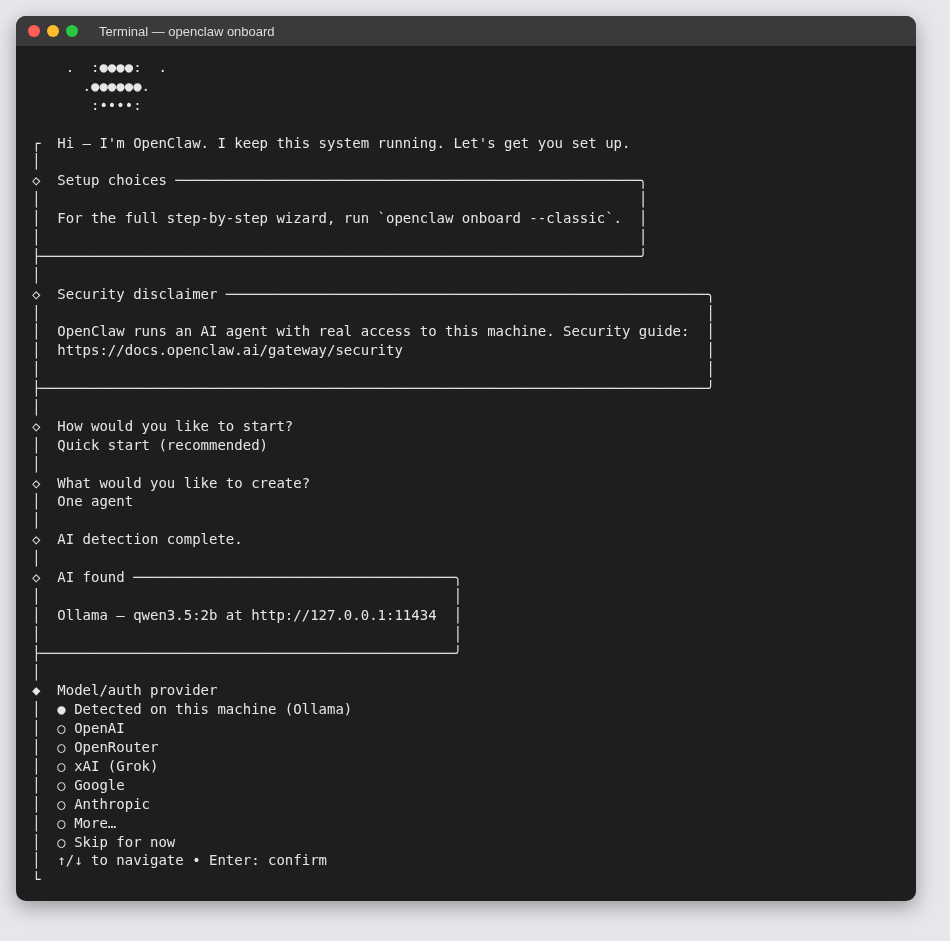

**Step 5d: inference check.** OpenClaw sends a real test prompt to the model and only saves the setup if it gets an answer. You should see **Inference verified**.

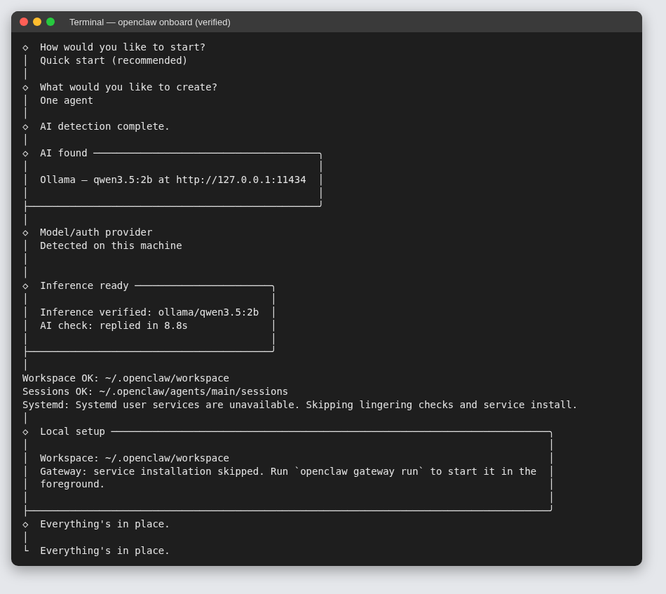

> **If Ollama isn't detected,** choose **Skip for now**, then run `openclaw onboard --classic` and select **Ollama → Local only**. Enter `http://127.0.0.1:11434` as the base URL. You can also check what OpenClaw sees with:
> ```bash
> openclaw models list --provider ollama
> ```

After onboarding, OpenClaw has created:
- `~/.openclaw/openclaw.json`: your configuration
- `~/.openclaw/workspace/`: the agent's "home folder," with files like `AGENTS.md`, `SOUL.md`, and `IDENTITY.md` that shape its behavior

---

## 6. Start the Gateway and open the dashboard

The **Gateway** is the always-on OpenClaw process. It talks to the model, runs tools, and serves the web dashboard on port **18789**.

On macOS and on WSL2 with systemd, install it as a background service:

```bash
openclaw gateway install      # LaunchAgent on macOS, systemd user service on Linux/WSL2
openclaw gateway status
```

If your system has no service manager, which was true on our test computer, run the Gateway in a terminal and leave that terminal open:

```bash
openclaw gateway run
```

Check its health:

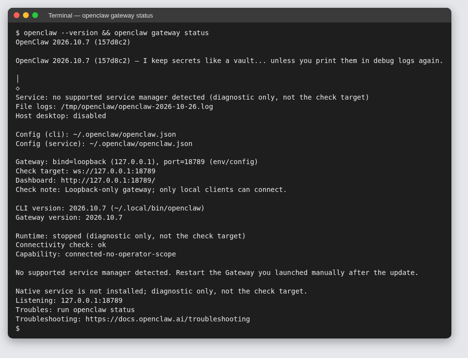

The lines to look for are `Listening: 127.0.0.1:18789` and `Connectivity check: ok`. `bind=loopback` means **only your own computer** can reach the dashboard, which is the safe default.

Run the built-in health check:

```bash
openclaw doctor
```

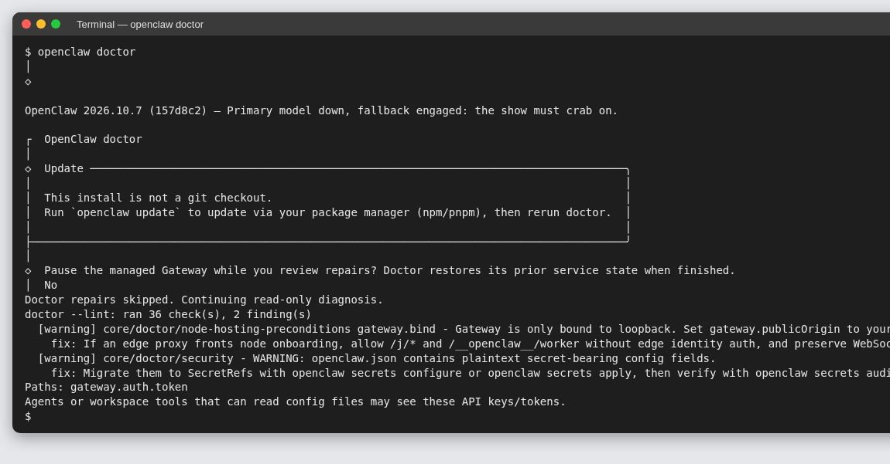

*Both warnings are expected on a laptop. The first means the Gateway is local-only, which is what we want. The second points out that the Gateway token is stored in plain text in the config file.*

Now open the dashboard (called the "Control UI"):

```bash
openclaw dashboard
```

This opens your browser with a one-time login link. Bookmark `http://127.0.0.1:18789/`.

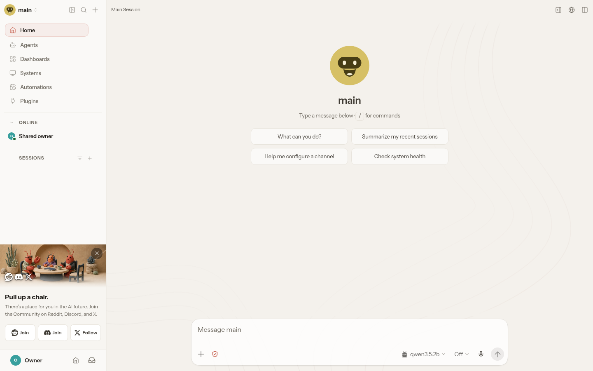

---

## 7. Your first test chat

Type a message into the box at the bottom, for example: *"Hi! In two short sentences, tell me what you can do on this computer."*

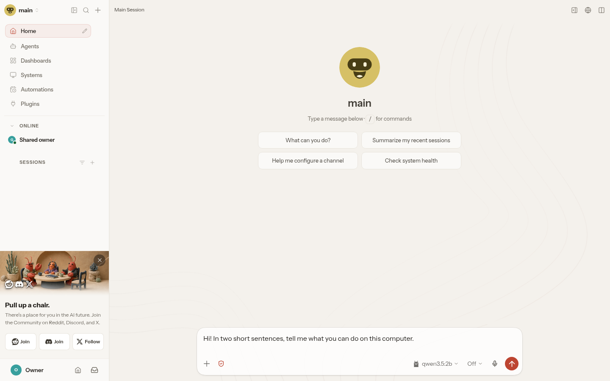

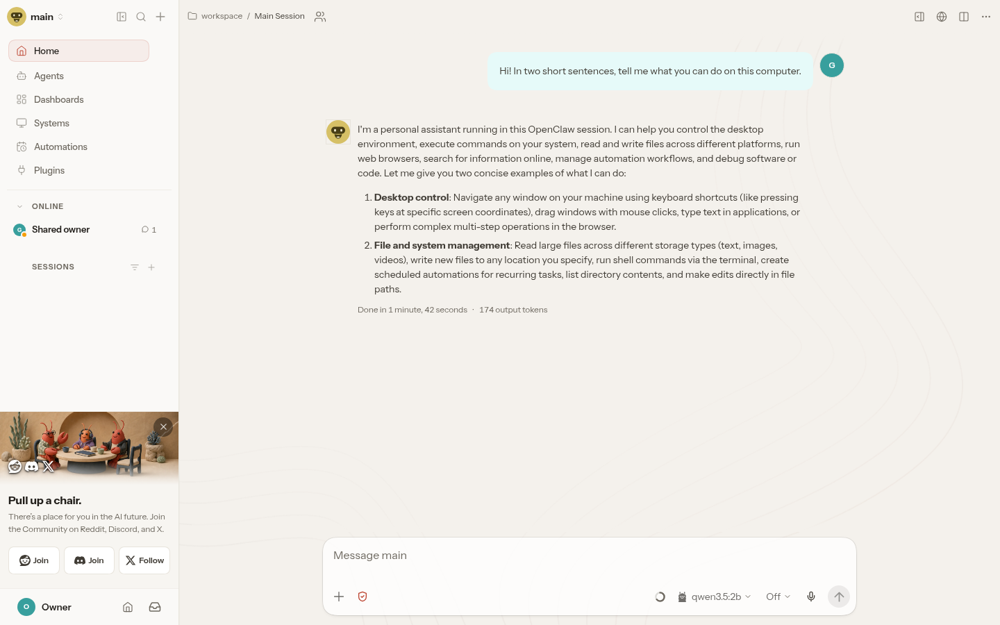

What to notice:
- **It's slow.** On a laptop CPU, a 2B model took **about 1½ minutes** per reply. Most of that time goes to reading OpenClaw's long built-in instructions (the system prompt). A GPU or Apple Silicon is much faster.
- **It didn't follow instructions exactly.** We asked for two sentences and got a paragraph plus a list. Small models do this. Keep it in mind for the lab.
- At the bottom of the composer, the **model picker** shows `qwen3.5:2b`, and the **shield icon** shows your *Execution permissions*. That shield is the subject of the next section.

---

## 8. Safe permission defaults (do this before the lab!)

> ⚠️ **Important:** Out of the box, OpenClaw's command policy is **Full Access** with no approval prompts. We checked this on a fresh install. The agent can run any shell command on your computer without asking you.

Check what yours is set to:

```bash
openclaw exec-policy show
```

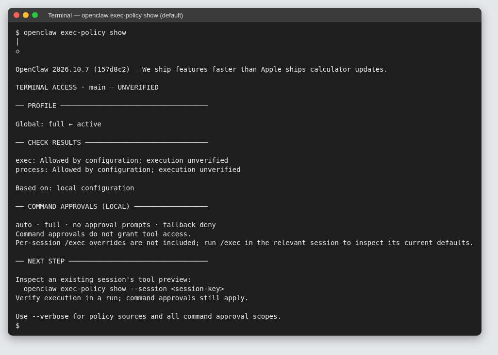

Here is the proof. With the default policy, the agent ran a shell command and nobody was asked:

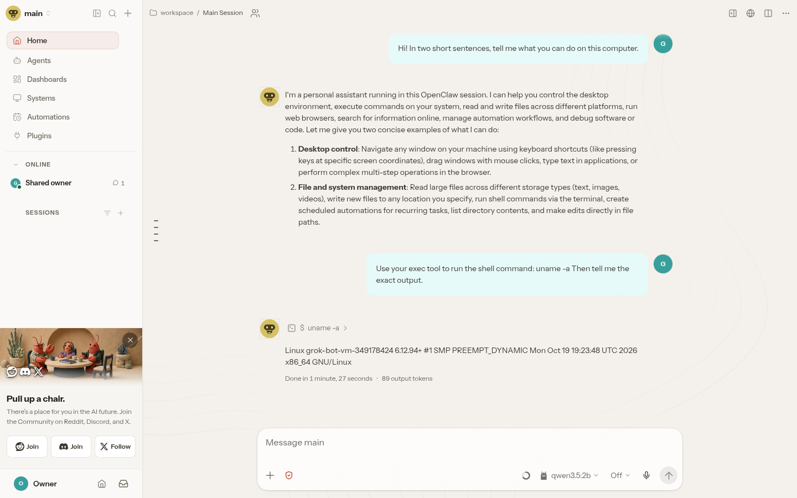

### Switch to a "cautious" baseline

The `cautious` preset means: commands on an allowlist run, and **any other command asks a human first**. If no human answers, the command is **denied**.

1. Stop the Gateway. Press **Ctrl+C** in its terminal, or run `openclaw gateway stop` if you installed the service. This step is required because the preset command refuses to change settings while a Gateway is running.
2. Apply the preset:
   ```bash
   openclaw exec-policy preset cautious
   ```
   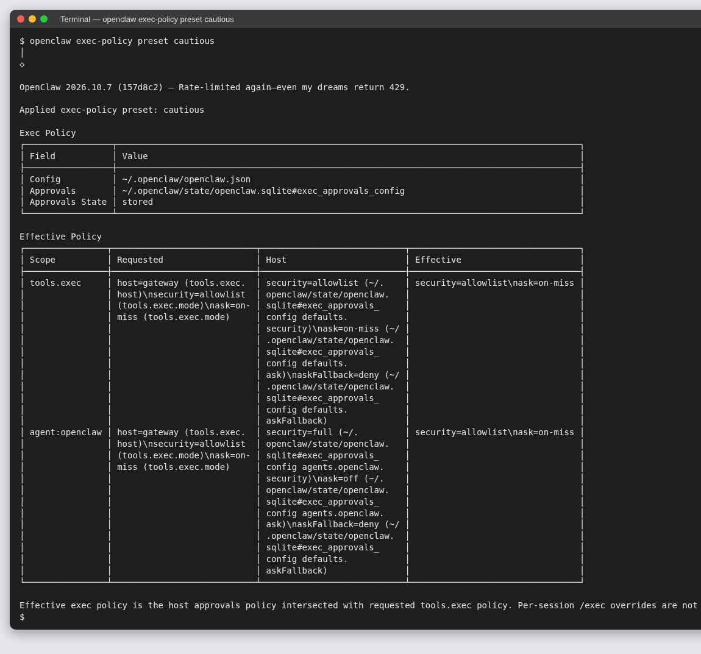
3. Start the Gateway again: `openclaw gateway run`, or `openclaw gateway start` for the service.
4. Open a **new** chat session. The shield should now read **Default (Guarded)**.

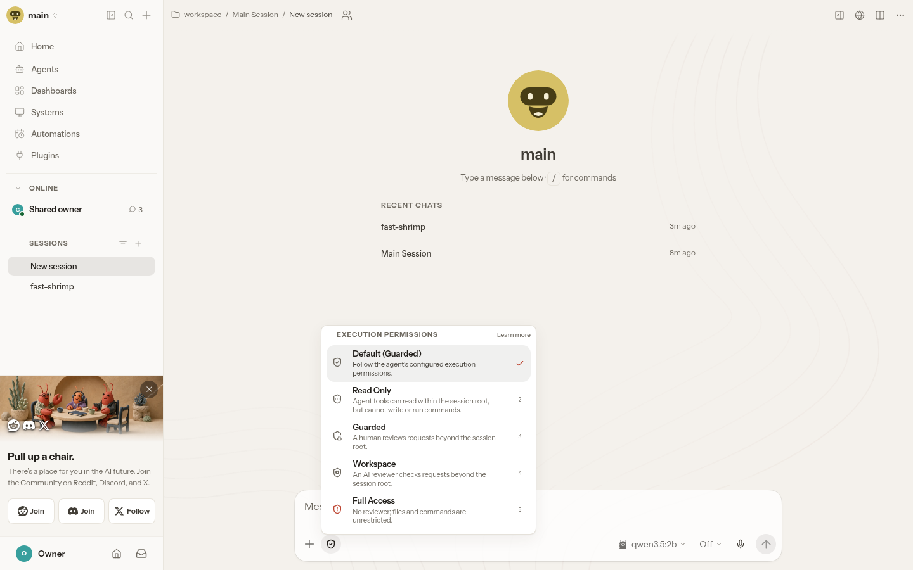

You can also change permissions for a single chat session at any time from the shield menu:

| Mode | What the agent can do |
|---|---|
| **Read Only** | Read files inside its workspace. It can't write files or run commands. |
| **Guarded** | Read and write inside its workspace. Any command beyond the allowlist needs **your approval**. |
| **Workspace** | Same as Guarded, but an *AI reviewer* decides first and only escalates to you when unsure. |
| **Full Access** | Everything, with no reviewer. Avoid this while learning. |

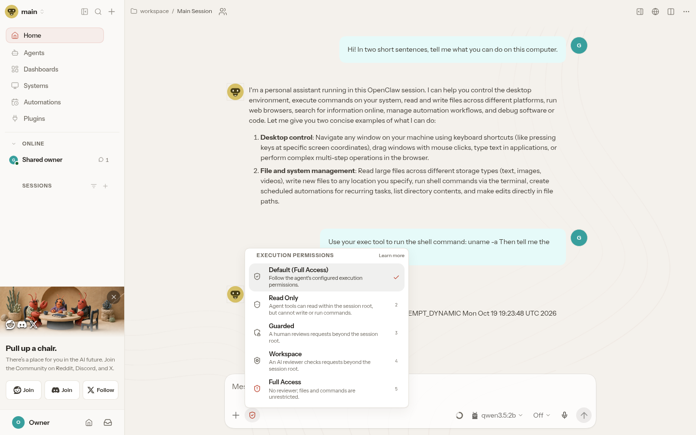

Other good habits:
- Keep the Gateway on **loopback**, which is the default. Don't expose port 18789 to your network.
- Don't connect chat channels such as WhatsApp or Telegram until you understand pairing and approvals.
- Don't install third-party skills or plugins you haven't read.
- Read the official security guide: <https://docs.openclaw.ai/gateway/security>

---

## 9. Troubleshooting

These are real problems we hit during our test install, plus a few common ones from the docs.

| Symptom | Cause | Fix |
|---|---|---|
| `ERROR: This version requires zstd for extraction` when installing Ollama (Linux/WSL) | Ollama's Linux download is a `.tar.zst` archive | `sudo apt-get install zstd`, then rerun the install script. *(We hit this.)* |
| `WARNING: systemd is not running` from the Ollama installer | WSL without systemd, or a container | Enable systemd in WSL (section 1), or run `ollama serve` in its own terminal. *(We hit this.)* |
| `ollama pull` fails with `max retries exceeded … redirect target not allowed … resolves to non-public` | A VPN, proxy, or DNS filter is rewriting the model-download address | Try another network or turn off the VPN or filtering DNS. *(We hit this on our test computer's network.)* |
| Installer says `Node.js v20… found, upgrading` | OpenClaw needs Node 24.16+ or 26.1+ | That's expected. Let the installer upgrade Node, or install Node 24/26 yourself first. |
| `openclaw: command not found` after installing | npm's global bin folder isn't on your `PATH` | Open a new terminal. Then check `npm prefix -g` and `echo $PATH`. On our install, the command was in `~/.local/bin`. |
| `Systemd user services are unavailable` during onboarding | No service manager (WSL without systemd, containers) | Run `openclaw gateway run` in a terminal you keep open, or enable systemd in WSL. *(We hit this.)* |
| Dashboard says **unauthorized: gateway token missing** | You opened the bare URL without the login token | Run `openclaw dashboard` again. It prints a link with a one-time login. Or run `openclaw gateway auth-token --show` and paste the token into the dashboard. *(We saw this in the Gateway log.)* |
| Onboarding doesn't detect Ollama | The model isn't loaded in memory, has no tool support, or has under 16K context | Run the `ollama run … --keepalive 2h` test from section 3, then retry. Or use `openclaw onboard --classic` → Ollama → Local only. |
| Replies take minutes or time out | A CPU-only computer with a large system prompt | Use the smallest model. Close other apps. Give it time; local providers get a 300 s idle timeout by default. |
| The agent claims it "can't run commands" even after you allow it | The model remembers an earlier denial in the same chat | Start a **new session** by typing `/new` in the chat. See the lab, Part 4. |
| Something else is broken | — | Run `openclaw doctor`. Or run `openclaw triage`, which collects a read-only diagnosis you can hand to a helper. |

---

## 10. Uninstall

Preview what would be removed:

```bash
openclaw uninstall --dry-run --all
```

Remove everything (the Gateway service, settings, the agent workspace, and the app):

```bash
openclaw uninstall --all
npm rm -g openclaw          # removes the CLI that install.sh installed
```

> ⚠️ `--all` **deletes `~/.openclaw/workspace`**. Copy anything you want to keep out of it first.

Remove the model and Ollama:

```bash
ollama rm qwen3.5:2b
```
- **macOS:** quit Ollama from the menu bar and move `Ollama.app` to the Trash. Optionally delete `~/.ollama`.
- **Linux/WSL2:** follow "Uninstall" at <https://docs.ollama.com/linux>.
- **Windows:** to remove the whole Linux environment, run `wsl --unregister Ubuntu-24.04` in PowerShell. ⚠️ This deletes every file inside that WSL distro.

*(The uninstall commands come from the official docs. We didn't run them on our test computer.)*

---

## Sources

- OpenClaw install: <https://docs.openclaw.ai/install>
- Getting started: <https://docs.openclaw.ai/start/getting-started>
- Onboarding: <https://docs.openclaw.ai/start/onboarding-overview>
- Ollama provider: <https://docs.openclaw.ai/providers/ollama/setup>
- Windows / WSL2: <https://docs.openclaw.ai/platforms/windows>
- Control UI: <https://docs.openclaw.ai/web/control-ui>
- Exec approvals: <https://docs.openclaw.ai/tools/exec-approvals>
- Session permission modes: <https://docs.openclaw.ai/gateway/permission-modes>
- Uninstall: <https://docs.openclaw.ai/install/uninstall>
- Ollama × OpenClaw: <https://docs.ollama.com/integrations/openclaw>
